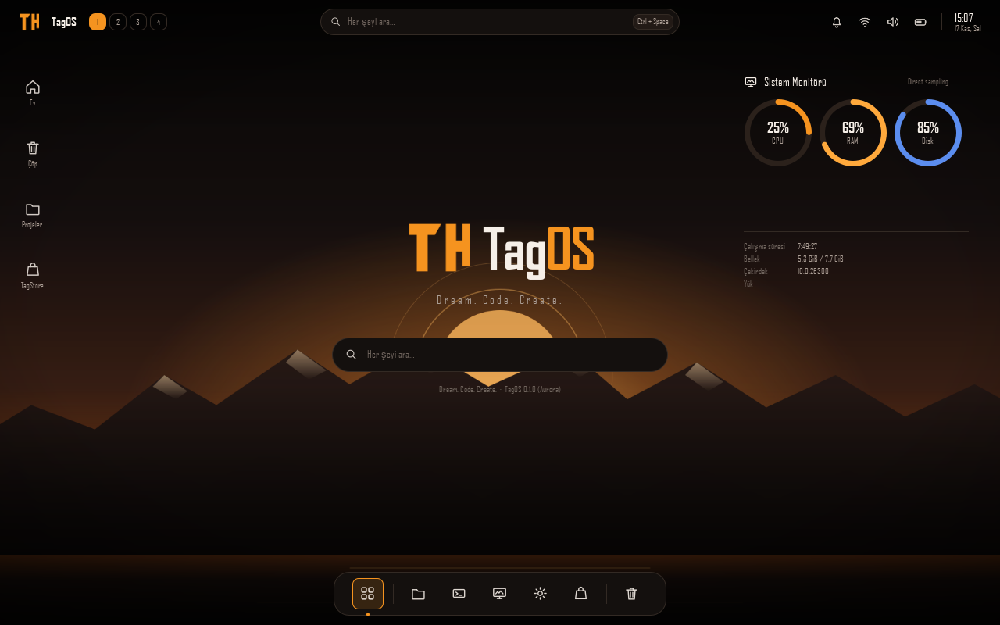

# TagOS

**The Operating System — Dream. Code. Create.**

TagOS is a Linux distribution with its own desktop environment: its own shell,
system services, applications and installation media. It is **not** a themed
Arch install — Arch is the foundation, everything above the kernel, systemd and
the compositor is TagOS code.

```
╔══════════════════════════════════════════════════════════════════════╗
║  TAGOS USER EXPERIENCE                                               ║
║  Board · Top bar · Dock · Launcher · Control centre                  ║
╠══════════════════════════════════════════════════════════════════════╣
║  APPLICATION & SERVICE LAYER                                         ║
║  TagMonitor · tag-flowd · (TagFiles, TagSettings, TagStore, …)       ║
╠══════════════════════════════════════════════════════════════════════╣
║  DESKTOP PLATFORM            Wayland + labwc                         ║
║  GRAPHICAL FRAMEWORK         Qt 6 · QML · C++20                      ║
╠══════════════════════════════════════════════════════════════════════╣
║  SYSTEM FOUNDATION                                                   ║
║  Arch Linux · Linux kernel · systemd · Mesa · PipeWire ·             ║
║  NetworkManager · BlueZ · D-Bus                                      ║
╠══════════════════════════════════════════════════════════════════════╣
║  HARDWARE            bare metal · QEMU/UEFI (development target)     ║
╚══════════════════════════════════════════════════════════════════════╝
```



*Rendered by `tag-shell --screenshot` from this tree: the real board, top bar,
docks and live TagMonitor card (`cpu`/`RAM`/`disk` read from `tagos-metrics`).*

## Status: Phase 0 — Foundation (v0.1.0 «Aurora»)

| Deliverable | State |
| --- | --- |
| Modular monorepo (CMake, Qt 6, C++20) | done |
| `tag-system` metrics/probe library (procfs, testable with fixtures) | done |
| `tag-flow` IPC layer + `tag-flowd` D-Bus service | done (D-Bus backend builds on Linux) |
| `TagOS.Design` design system (tokens + components + icons + wallpaper) | done |
| `tag-shell` desktop board (top bar, docks, launcher, TagCenter) | done |
| `TagMonitor` second application reusing the same modules | done |
| systemd user session (`tag-session.target`, `tag-flow`, `tag-shell`) | done |
| labwc + greetd session configuration and sandboxing | done |
| archiso live/installation profile + boot marker | done |
| QEMU UEFI runner (3 GiB / 4 vCPU / 32 GiB / 1280×800) | done |
| Automated tests: unit, QML smoke, repository checks, QEMU boot | done |

Phase 0 is a *working foundation*, verified by tests — not a finished desktop.
See [docs/phase-0.md](docs/phase-0.md) for the exact acceptance criteria and how
each one is checked, and [docs/roadmap.md](docs/roadmap.md) for phases 1–7.

## Quick start

### On Arch Linux (supported build host)

```bash
# dependencies
sudo pacman -S --needed git cmake ninja gcc pkgconf qt6-base qt6-declarative \
    qt6-svg qt6-tools python qemu-full edk2-ovmf archiso squashfs-tools libisoburn

# build + test
tools/build.sh

# run the shell on the current Wayland/Weston session (development)
QT_QPA_PLATFORM=wayland ./build/dev/bin/tag-shell

# build a bootable ISO and verify it boots under UEFI
sudo tools/build-iso.sh
```

### On a Windows developer machine (UI work only)

TagOS targets Linux, but the shell and the design system can be built and
smoke-tested on Windows with MSYS2 UCRT64 + Qt 6:

```bash
cmake -S . -B build/win -G Ninja
cmake --build build/win
ctest --test-dir build/win --output-on-failure
./build/win/bin/tag-shell --smoke-test
```

`TagFlow` falls back to in-process sampling when QtDBus is not part of the
build, so the UI binds to the same API as on a real TagOS host.

## Layout

```
core/
  tag-system/     platform probe library: procfs parsers, CPU sampler, formats,
                  os-release, power actions, process launching      (+ unit tests)
  tagflow/        metrics IPC: FlowClient (QML), local/D-Bus backends,
                  dbus/org.tagos.Flow1.xml contract, tag-flowd
  tag-session/    session entry point handed to greetd
desktop/
  tag-design/     TagOS.Design: Theme tokens, TagButton/Card/Toggle/RingGauge/
                  Sparkline/Slider/Icon
  tagshell/       tag-shell: board, top bar, docks, launcher, TagCenter
apps/
  tag-monitor/    tag-monitor: CPU/RAM/disk history on the same modules
themes/           icons + wallpapers compiled into TagOS.Design
system/
  systemd/        user session target + services, boot marker unit
  config/         labwc, greetd, environment.d
  packages/       base / desktop / dev / live package lists
  scripts/        boot marker helper
installer/archiso/ live + installation medium profile
tools/            build.sh, build-iso.sh, run-qemu.sh, lint.sh
tests/            unit/ (QTest), system/ (repo checks), integration/ (QEMU boot)
docs/             architecture, roadmap, phase 0, ADRs
```

## Principles

1. **Working infrastructure first.** Every phase must boot and be verifiable
   before the next one starts.
2. **Modules, not a monolith.** No module includes another module's private
   headers; cross-process communication goes through D-Bus (`org.tagos.*`).
3. **Degrade, never crash.** A missing metrics service falls back to local
   sampling; a missing application shows a roadmap phase instead of a dead tile.
4. **Do not reimplement Linux.** Network, audio and Bluetooth are NetworkManager,
   PipeWire and BlueZ with a TagOS interface — not new daemons.
5. **Least privilege.** Metrics run as a user service with
   `NoNewPrivileges`, `ProtectSystem=strict` and an empty capability set.
6. **One design system.** A hex value outside `TagOS.Design/Theme.qml` is a bug.

## Documentation

- [Architecture](docs/architecture.md) — layers, contracts, boot flow, security
- [Phase 0](docs/phase-0.md) — acceptance criteria and verification commands
- [Roadmap](docs/roadmap.md) — phases 1–7
- [Modules](docs/modules.md) — module table, interfaces, tests
- [Building](docs/building.md) — host setup, ISO, QEMU, Windows dev host
- [ADRs](docs/adr/) — recorded decisions
