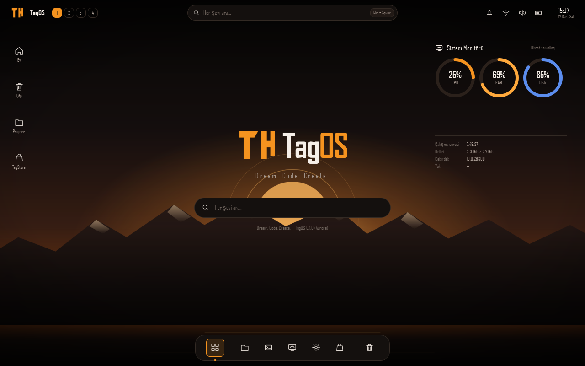

# Phase 0 — Foundation (TagOS v0.1.0 «Aurora»)

Goal: **a clean TagOS base that boots under UEFI, starts a Wayland session with
labwc, opens a Qt 6/QML shell, reports CPU/RAM, can reboot, and is verified by
automated tests.** No installer wizard, no store, no AI — those are later phases.

## Acceptance criteria

| # | Criterion | Implementation | How it is verified |
| --- | --- | --- | --- |
| 1 | Arch Linux base prepared | `system/packages/{base,desktop,live}.txt`, archiso profile | `tests/system/test_system_files.py` (package lists, profile completeness) |
| 2 | Boots in QEMU with UEFI | `installer/archiso/tagos` (uefi.systemd-boot), `tools/run-qemu.sh` (OVMF) | `tests/integration/boot-test.sh` |
| 3 | A user session starts | `core/tag-session/tag-session`, greetd autologin on live media | boot test: session readiness file + `TAGOS_BOOT_OK` |
| 4 | Wayland is running | `XDG_SESSION_TYPE=wayland`, labwc compositor, `environment.d` | boot test (`tag-shell` reports platform), manual `echo $XDG_SESSION_TYPE` |
| 5 | labwc window management works | `system/config/labwc/{rc.xml,menu.xml,themerc,autostart}` | XML parse check; manual window/shortcut check in the VM |
| 6 | A Qt 6/QML app opens | `tag-shell` (board, bars, docks, launcher) | `ctest` → `desktop-shell-smoke` (loads every QML file offscreen) |
| 7 | Base project for the TagOS desktop | monorepo with `tag-design`, `tagshell`, `tag-monitor`, `tag-system`, `tagflow` | `cmake --build`, `ctest`, `tools/lint.sh` |
| 8 | CPU and RAM can be measured | `tag-system` procfs parsers + sampler, `tag-flowd`, `FlowClient` | `tst_procfs`, `tst_cpu_sampler`, `tst_metrics_codec`, `tst_flow_wire`; `tagos-metrics` |
| 9 | The system can reboot | `PowerManager` → logind/polkit; live polkit rule | `TagCenter` buttons; unit-tested dry-run path (`TAGOS_DRY_RUN=1`) |
| 10 | Tests run automatically | CTest: unit + QML smoke + repo checks + QEMU boot | `ctest --output-on-failure`, CI workflow |

## Test inventory

```
ctest --test-dir build/dev --output-on-failure

  tst_procfs          /proc/stat, /proc/meminfo, loadavg, uptime parsers (fixtures)
  tst_cpu_sampler     CPU percentage math: deltas, clamping, counter regressions
  tst_format          byte/uptime/percent/load formatting shared by every surface
  tst_osrelease       /etc/os-release parsing and display-name fallbacks
  tst_metrics_codec   JSON snapshot round-trip (used by tagos-metrics / boot test)
  tst_flow_wire       TagFlow a{sv} wire format round-trip and schema rejection
  repo-system-units   systemd units, labwc/greetd config, archiso profile, package lists
  desktop-shell-smoke loads the entire shell offscreen; fails on any QML runtime error
  integration/boot-test.sh   QEMU + UEFI + serial: TAGOS_BOOT_OK after a real session
```

`desktop-shell-smoke` is stricter than "did it load": the shell installs a
message handler that counts QML runtime errors (`TypeError`, unassignable
bindings, missing modules) and exits non-zero, which is how the design-token and
singleton bugs were caught during development.



The screenshot above is produced by the shell itself:

```bash
QT_QPA_PLATFORM=offscreen QT_QUICK_BACKEND=software TAGOS_DRY_RUN=1     ./build/dev/bin/tag-shell --screenshot out/shell.png
```

## Manual verification in the VM

```bash
sudo tools/build-iso.sh                     # builds, tests, boots, verifies
tools/run-qemu.sh --iso out/tagos.iso       # interactive SPICE session
```

Inside the live session:

1. the board shows wallpaper, top bar, side dock, bottom dock;
2. the TagMonitor card reports CPU/RAM/disk and a CPU sparkline;
3. `Ctrl+Space` opens the launcher; unavailable apps show their roadmap phase;
4. the clock area opens TagCenter; **Yeniden Başlat** reboots the VM;
5. `tagos-metrics` in the VM's terminal prints the same numbers as the card.

## Known limits of this phase

* One full-screen shell surface — no layer-shell panels yet (Phase 1).
* No installer wizard; the ISO boots a live session (Phase 5).
* Network/audio/Bluetooth tiles are placeholders labelled "Faz 2".
* QEMU uses virtio-gpu; real GPU drivers are Phase 6.
